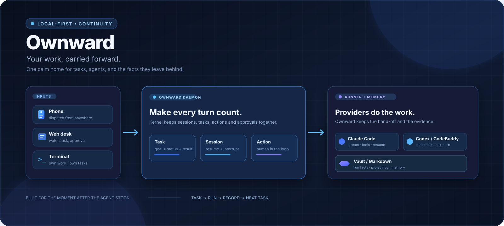
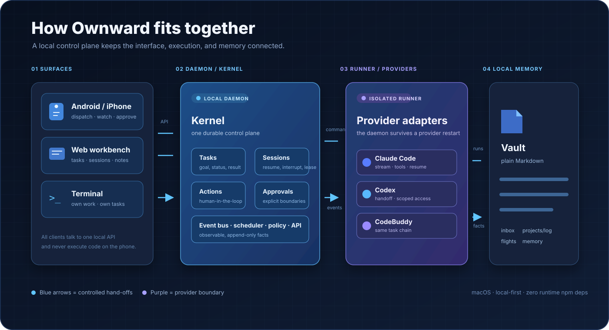
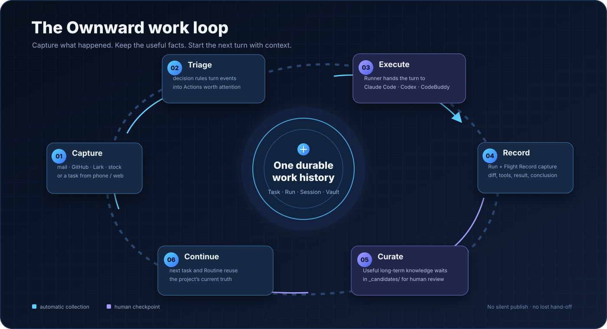
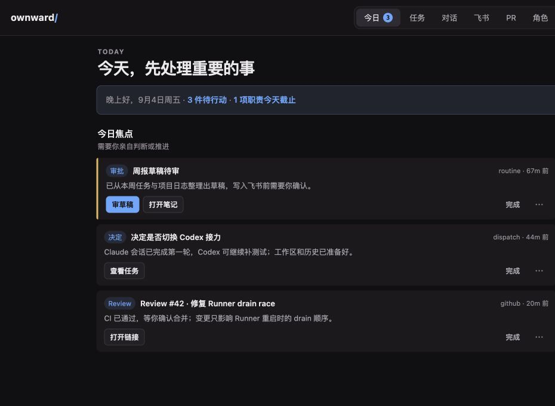

# Ownward

English | [简体中文](README.zh-CN.md)

> Your work, carried forward.



Ownward is a local AI workbench for **macOS**. You dispatch tasks from the web, your phone or a terminal, and Claude Code, Codex or CodeBuddy carries them out. What happened along the way — the process, the code changes and the conclusions — is filed back into that project's Markdown memory.

It is not yet another chat box. It targets the part of AI-assisted programming that breaks most easily: **the task keeps going after you walk away from your computer, switching agents doesn't mean re-explaining the context, and the next session can find the facts the last one left behind.**

> **Status**: Under active development. The server runs on macOS only; the phone apps are a remote control surface, while your code, credentials and agent CLIs always stay on your Mac.

## What it is, and what it isn't

| Ownward is | Ownward is not |
| --- | --- |
| A local background service (daemon) plus a separate execution process (Runner) | An IDE or editor replacement |
| One task control plane for Claude Code / Codex / CodeBuddy | A security sandbox for agents |
| A workbench you can check, follow up on, approve from and hand off from your phone | A cloud code-execution service |
| A record layer that writes Runs, diffs, commits and conclusions back to the project | A proxy or accelerator for Claude, Codex or CodeBuddy |

The phone is only for dispatching tasks, watching progress and making decisions. The agents that actually run commands live on your Mac and inherit your user account's permissions. Background `worktree`s isolate the Git working directory, but they are **not a permission boundary**.

## The workflow in 90 seconds



A unit of work goes through six steps:

1. **Input**: write a task from your phone, the web or a terminal, or let event sources such as GitHub, Feishu (Lark) or Gmail feed the notification stream.
2. **Triage**: rules turn the things worth your attention into action cards; ordinary noise only goes to the log.
3. **Execute**: the Runner hands the task to Claude Code, Codex or CodeBuddy. When needed, the same task can be handed off to another engine.
4. **Record**: every execution round is a Run; when the task ends, a Flight Record captures the goal, a summary of tool calls, the diff, tests and the conclusion.
5. **Confirm**: reusable long-term knowledge lands in `_candidates/` first and only becomes the project's current truth after a human confirms it. Routine drafts written to external documents pass the same human review gate.
6. **Continue**: the next task or weekly report reuses the project memory directly instead of digging through old chats.



### Two kinds of "continue" — don't mix them up

- **Task sessions** have a real working directory, permissions and task state. You can follow up, approve, interrupt, and hand off between Claude Code / Codex / CodeBuddy.
- **Plain Chat** only replays the chat history and carries no task workspace. It's good for discussion and questions, not for having an agent change code directly.

### The jargon in plain words

| Term | Meaning |
| --- | --- |
| Task | Something you hand to an agent |
| Session | The ongoing conversation context with an agent |
| Run | One execution round inside a Session |
| Action | A card on the Today page that needs you to confirm, reply or decide |
| Flight Record | An auditable record after a task finishes: goal, diff, tests, conclusion |
| Routine | A recurring deliverable drafted on schedule and waiting for your review |
| Provider | An execution engine such as Claude Code, Codex or CodeBuddy |
| worktree | An isolated Git working directory — not a security sandbox |

## Up and running in 3 minutes

### 1. Prerequisites

- macOS
- [Bun](https://bun.sh)
- Git (included with the Xcode Command Line Tools)
- At least one agent CLI you're logged in to: [Claude Code](https://claude.com/claude-code), [Codex CLI](https://github.com/openai/codex), or optionally Tencent's [CodeBuddy](https://copilot.tencent.com)

If the installer can't find Claude or Codex, it still starts the daemon, but AI-driven features such as triage and heartbeat won't work. Install a CLI later and rerun `bash install.sh`.

### 2. Install and open the workbench

```bash
git clone https://github.com/whtis/ownward.git
cd ownward
./install.sh
open http://127.0.0.1:4517
```

The first install asks two local questions: what to call you (optional) and where the vault lives (default `~/Documents/ownward-vault`). The script writes a `config.json` that never goes into Git, installs the `own` CLI, and starts the daemon and the separate Runner as one launchd transaction.

The install transaction builds, health-checks and runs a provider canary, so the first run can take a few minutes. It is confirming that the new version can be rolled back before switching the background services over — it isn't stuck.

Open **Settings → AI engines**:

1. Make sure the providers you're logged in to are enabled. CodeBuddy alone can run the full task pipeline, though CodeBuddy itself still needs a login and network access.
2. Under **Dispatch defaults**, pick a project directory, provider, model and permission mode.
3. Click **New task** in the top-right corner, enter a small task such as "add a failing-case test for the login page", check **Run in background**, and dispatch.

When it works, you'll see live output on the **Tasks** page and action cards that need you on the **Today** page; after the task finishes you can review the diff, tests and Flight Record.

### 3. Rather not click around? Use the CLI

```bash
# Open in a foreground Terminal — good when you may want to take over at any moment
bin/own work ~/workspace/example "Fix the login page crash"

# Run in the background in an isolated worktree — good for letting the agent run tests on its own
bin/own work ~/workspace/example "Fill in the unit tests" --bg
bin/own work ~/workspace/example "Refactor the utils directory" --bg --codex

bin/own status       # daemon and queue status
bin/own tasks        # task list
bin/own logs         # daemon logs
bin/own done <id>    # harvest a finished terminal task
```



<sub>The screenshot was produced by an isolated test daemon (port 4519) with mock actions/routines. It only shows the layout and contains no production data.</sub>

## Core usage

### Dispatch, watch, take over

The Tasks page puts running tasks next to recent agent sessions. You can follow up, expand tool calls, approve high-risk operations, add writable directories, and check repository status, diffs, tests and commits. When a task is done there's no need to reopen the original CLI — wrap it up right in the workbench.

### Cross-engine handoff

When Claude is rate-limited, you need a different capability, or you just want Codex to do another review, hand the task to another provider. Ownward keeps the old session and execution record, injects only a bounded slice of recent history into the new engine, and asks it to check the current Git and file state first so already-executed tool calls aren't replayed.

The old session isn't lost after a handoff: the session page's **Session lineage & resume commands** lists every engine's native session ID in the chain, each with a resume command you can paste straight into a terminal (`claude --resume …` / `codex resume …` / `codebuddy --resume …`). Sessions replaced by `/new` are listed there too.

Switching only the model or reasoning effort within the same engine is **not a handoff**: `/model opus` or `/effort high` in the session settings dialog or the input box changes the parameters in place, and the next round continues the same native session (Claude Code's `--resume` and Codex's `exec resume` both accept new parameters), so not a word of the native context is lost.

```text
Claude Code ──rate limit / capability──→ Codex ──same workspace──→ CodeBuddy
      └────────────── old sessions, Runs and Flight Records stay reviewable ──────────────┘
```

### Automatic harvesting and project memory

Substantial Claude Code and Codex CLI sessions you run outside Ownward are discovered and harvested automatically. CodeBuddy's private transcripts can't be read back from outside, so only CodeBuddy tasks started by Ownward are recorded.

The default vault is plain Markdown that you can open with Git, Obsidian or any editor:

```text
~/Documents/ownward-vault/
├── ownward/             # Ownward's own daily log
├── inbox/               # recent material harvested from sessions
├── projects/<slug>/     # project README, evolution log and current truth
├── flights/             # auditable execution record for each task
├── memory/              # people / preferences / commitments / goals
│   └── _candidates/     # long-term knowledge proposed by the model, awaiting your confirmation
└── daily/               # automatic daily digest
```

### Routines: get a draft for recurring duties

Recurring deliverables such as stand-ups, weekly reports and project syncs can be set up as Routines. Ahead of time, Ownward drafts them from your recent work; only after you review the draft does it dispatch a task to write it into the Feishu (Lark) document. Routines are off by default — copy a sample from [examples/routines.json](examples/routines.json) to `data/routines.json`.

## Where your data lives and who can see it

| Data | Default location / destination | What to know |
| --- | --- | --- |
| Config, tasks, logs, action cards | `data/` on your Mac | Never commit `config.json`, `data/`, credentials or the vault to Git |
| Project memory | The Markdown vault you choose | Search, edit, commit and back it up yourself |
| Agent input and tool calls | Sent to the selected provider | Governed by Anthropic's / OpenAI's / Tencent's own terms of service |
| Phone access | Listens on `127.0.0.1:4517` only by default | Remote access requires TLS / Tailscale plus an Ownward token |

Keep these four security boundaries in mind:

- Only local access is allowed by default; `dashboard.listen=all` binds `0.0.0.0`, which is not "LAN-only by nature".
- Agents inherit every file and command your user account can access. The `safe` approval mode suits daily use; turn on `bypass` only when you explicitly accept the risk.
- A background worktree only isolates the Git checkout; it doesn't stop the agent from reaching other directories it has been granted.
- Ownward keeps three human approval gates: high-risk operation approval, Routine document writes, and promotion of long-term memory candidates.

See [SECURITY.md](SECURITY.md) for the full security notes. Before connecting your phone remotely, read the [remote access guide](docs/remote-access.md).

## Support matrix

| Capability | Claude Code | Codex | CodeBuddy |
| --- | :---: | :---: | :---: |
| Dispatch, continue, watch and wrap up inside Ownward | ✓ | ✓ | ✓ |
| Cross-engine handoff of task sessions | ✓ | ✓ | ✓ |
| Cross-engine continuation of plain Chat | ✓ | ✓ | Depends on config |
| Unified Run / Flight Record | ✓ | ✓ | ✓ |
| Automatic harvesting of external CLI sessions | ✓ | ✓ | — |

Clients and optional event sources:

- **Web workbench**: served by the daemon, by default at `http://127.0.0.1:4517`.
- **Android**: get it from [GitHub Releases](https://github.com/whtis/ownward/releases); code is never copied to the phone to run.
- **iPhone**: requires iOS 26+ and can be installed on a device with Xcode; the TestFlight channel is provided by the publisher. Build instructions are in [ios/README.md](ios/README.md).
- **Feishu (Lark) / GitHub / Gmail / stocks**: off by default; setup and credentials are described in [docs/configuration.md](docs/configuration.md).

## CLI cheat sheet and basic troubleshooting

| Symptom | What to try first |
| --- | --- |
| The browser can't open port 4517 | Run `bin/own status`, then `bin/own logs`; make sure no other process is using the port |
| `own` not found | Add `~/.local/bin` to your `PATH`, or use `bin/own` directly |
| A provider shows as disabled | Enable it under **Settings → AI engines**, confirm the CLI is logged in, then rerun `bash install.sh` |
| A background task isn't moving | Check the Runner status and `bin/own logs`; don't manually replay a task whose outcome is unknown |
| The phone can't connect | Don't expose 4517 directly to the internet; set up TLS / Tailscale / a token following the [remote access guide](docs/remote-access.md) |

## Optional integrations

Ownward's core task pipeline needs no external accounts. Turn these on when you need them:

- Feishu (Lark): messages, calendar, Routine document writes and DM notifications;
- GitHub: notifications, the PR workbench and review requests;
- Gmail: email triage and action cards;
- Stocks: scheduled quote checks for a watchlist at set times;
- Strategy: adds thesis cards, position rules and stop-loss monitoring on top of the above; off by default.

Each event source has to be enabled on the settings page with its CLI / credentials in place. From the terminal, set `connectors.<name>.enabled` (older `sources.*` keys still work). Details are in [docs/configuration.md](docs/configuration.md).

## Developing Ownward

Ownward is a Bun / TypeScript daemon plus a static web UI with no build step, and it has zero npm runtime dependencies. Provider tasks run in the separate Runner, and the daemon drains safely before it restarts.

```bash
bun install --frozen-lockfile
./verify.sh
```

The verification gate covers bundling, TypeScript type checking, unit tests, a daemon smoke test, API probes and web JavaScript parsing. Read the [development guide](docs/development.md) before changing Ownward's own code; the contribution process is in [CONTRIBUTING.md](CONTRIBUTING.md), and the full architecture is in [docs/architecture-v1.md](docs/architecture-v1.md).

### Vertical extensions (advanced)

Ownward's development workbench is the built-in `dev` Vertical. The Kernel, Runner, Provider, Action, scheduling and storage layers form a reusable base; an external Vertical can declare its own routes, pages and domain data, and gets crash isolation and hot reload during development through a separate Host. It must be trusted local code that you explicitly enable — the separate process is not a sandbox for malicious code.

To build an extension, start with the [read-only sample Vertical](examples/verticals/sample-readonly) and the [extension contract](docs/contributing/extension-contract.md).

## Documentation map

- **First-time use**: this README → [Up and running in 3 minutes](#up-and-running-in-3-minutes) → [SECURITY.md](SECURITY.md)
- **Configuration and integrations**: [docs/configuration.md](docs/configuration.md)
- **Remote phone access**: [docs/remote-access.md](docs/remote-access.md)
- **Contributing code**: [CONTRIBUTING.md](CONTRIBUTING.md) → [docs/architecture-v1.md](docs/architecture-v1.md)
- **Developing a Vertical**: [docs/development.md](docs/development.md) → [docs/contributing/extension-contract.md](docs/contributing/extension-contract.md)
- **Security boundaries**: [SECURITY.md](SECURITY.md)
- **Releases and roadmap**: [CHANGELOG.md](CHANGELOG.md) · [ROADMAP.md](ROADMAP.md)

## License

[Apache License 2.0](LICENSE)
